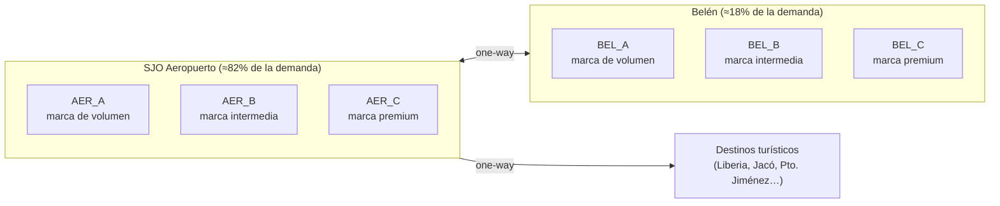

# Misión 1 — Diseño de la operación

> **Estado:** v1.0 · **Entregable:** documento de diseño de sucursales, categorías de auto y canales de reserva · **Datos:** `data/design/`

## 1. Resumen

El SJO Decision Lab simula una rentadora de autos con operación en el Aeropuerto Internacional Juan Santamaría (SJO) y en Belén. Toda la operación es **100% sintética**. Sus parámetros se calibran con estadísticas agregadas de un manifiesto semanal de reservas y con datos públicos de turismo de Costa Rica, sin copiar ningún registro real.

| Elemento | Diseño |
|---|---|
| Sedes | 2: SJO aeropuerto y Belén |
| Marcas | 3: de volumen, intermedia y premium |
| Oficinas | 6 (2 sedes × 3 marcas) |
| Categorías de auto | 8 (agrupan 46 clases ACRISS) |
| Canales de reserva | 3 (marca directo, agencia, agente/mostrador) |

## 2. Principios de diseño

1. **Sintético por construcción.** El repositorio no contiene nombres, números de reserva ni datos de contacto. Solo proporciones y medianas redondeadas.
2. **Calibrado, no copiado.** Cada parámetro tiene una fuente (manifiesto agregado o dato público) y está en un CSV versionado.
3. **Escalable.** Agregar una sede o una marca es agregar una fila, no reescribir el modelo.
4. **Reproducible.** `scripts/calibrate_from_manifest.py` regenera las tablas; `scripts/validate_design.py` las valida en cada commit.

## 3. Red de sucursales



| Oficina | Sede | Marca | Peso de la demanda | Duración mediana | Tarifa diaria mediana |
|---|---|---|---|---|---|
| AER_A | SJO | Volumen | 46,5 % | 7,0 días | 33 |
| AER_B | SJO | Intermedia | 22,7 % | 7,1 días | 46 |
| AER_C | SJO | Premium | 12,7 % | 6,8 días | 58 |
| BEL_A | Belén | Volumen | 14,3 % | 7,6 días | 34 |
| BEL_B | Belén | Intermedia | 0,6 % | 29,7 días | 35 |
| BEL_C | Belén | Premium | 3,2 % | 4,5 días | 53 |

**Lectura de negocio**

- La marca de volumen domina en precio bajo; la premium cobra cerca de 1,8 veces más por día; la intermedia queda en medio.
- Belén concentra los *one-way*: 16 % en BEL_A y 24 % en BEL_C, contra 4–10 % en el aeropuerto. Esa asimetría alimenta la decisión de **redistribución de flota**.
- BEL_B tiene una muestra muy pequeña (5 reservas, casi todas de largo plazo). Se modela como segmento de **alquiler largo**, no como un flujo de mostrador.

## 4. Categorías de auto

Las 46 clases ACRISS del manifiesto se agrupan en 8 categorías. La regla de agrupación está en `categoria()` dentro de `scripts/calibrate_from_manifest.py`.

| Categoría | Peso | Tarifa p10 / mediana / p90 | Observación |
|---|---|---|---|
| SUV_ESTANDAR | 23,8 % | 20 / 29 / 69 | La categoría más demandada |
| SUV_PREMIUM | 16,1 % | 29 / 71 / 113 | Mayor dispersión de precio |
| 4X4_JEEP | 15,0 % | 27 / 33 / 65 | Todo terreno, relevante para destinos de playa y montaña |
| SUV_INTERMEDIO | 13,4 % | 15 / 34 / 65 | |
| SUV_COMPACTO | 10,4 % | 24 / 32 / 57 | |
| SUV_GRANDE | 9,8 % | 34 / 52 / 89 | Incluye pickups (muy pocas) |
| AUTO | 7,8 % | 22 / 45 / 58 | Sedán y hatchback; la duración más corta (5 días) |
| VAN | 3,7 % | 75 / 125 / 161 | Baja frecuencia, ticket alto |

Los SUV y 4x4 suman cerca del 88 % de la demanda: **el mix de flota está muy sesgado a SUV**, y el modelo debe reflejarlo.

## 5. Canales de reserva

| Canal | Peso | Anticipación mediana | Tarifa diaria mediana | % con vuelo |
|---|---|---|---|---|
| MARCA_DIRECTO | 57,2 % | 27 días | 40 | 34 % |
| AGENCIA | 41,5 % | 26 días | 37 | 29 % |
| AGENTE_MOSTRADOR | 1,2 % | 26 días | 51 | 0 % |

- **MARCA_DIRECTO:** la reserva la hace la propia marca (web o central).
- **AGENCIA:** reserva con agencia o intermediario de referencia; tiene una tarifa mediana algo menor.
- **AGENTE_MOSTRADOR:** reserva asistida por un agente sin agencia. Es marginal en esta muestra.
- El **largo plazo** (≥ 28 días, tarifa personalizada) es un segmento aparte: menos del 2 % de las reservas.

## 6. Perfil de demanda

- **Día de la semana (recogidas):** el sábado concentra el 24,8 %; lunes y martes rondan el 10 %. Ver `demand_profile_dow.csv`.
- **Hora del día:** picos entre las 8:00–10:00 y las 12:00–14:00. Ver `demand_profile_hour.csv`.
- **Anticipación:** mediana de unas 4 semanas, con cola larga de reservas hechas con hasta casi un año de anticipación.
- **Duración:** mediana de 7 días.

## 7. Supuestos de flota (a validar en la Misión 2)

No hay una flota real publicada. El diseño propone dimensionarla así:

```
flota_categoria ≈ (demanda_semanal × duración_media) / (7 × utilización_objetivo)
```

con utilización objetivo de 75–85 % como punto de partida. La escala absoluta (número de autos y de reservas por semana) es un **parámetro de simulación**, no un dato del repo.

## 8. Decisiones que el sistema debe apoyar

1. **Precio dinámico:** ajustar la tarifa por categoría, sede y anticipación según demanda y disponibilidad.
2. **Redistribución de flota:** cuántos autos mover entre SJO y Belén para absorber los *one-way* y el pico del sábado.
3. **Sobreventa y no-show:** cuántas reservas aceptar por encima de la capacidad por categoría.
4. **Upgrades y sustituciones:** qué hacer cuando falta una categoría (por ejemplo, un SUV estándar por uno intermedio).

## 9. Limitaciones

- La muestra cubre **una sola semana** de recogidas confirmadas. No se observan cancelaciones, no-shows ni estacionalidad anual.
- Los pesos por oficina de baja frecuencia (BEL_B) tienen mucho ruido.
- Las tarifas se interpretan como USD por día; falta confirmar moneda e impuestos.
- La calibración con datos públicos de turismo (llegadas por aeropuerto y temporada) queda para la Misión 2.

## 10. Datos, ética y confidencialidad

- Las tablas son agregados redondeados; no permiten reconstruir ninguna reserva.
- Los identificadores de oficina y de marca son **genéricos** (`AER_A`, `MARCA_VOLUMEN`). El mapa hacia los códigos reales vive en `data/raw/`, que está en `.gitignore`.
- El manifiesto original **no se versiona**. Si se calibra con datos de un empleador, conviene confirmar que la publicación de proporciones agregadas esté permitida.

## 11. Criterios de aceptación de la Misión 1

- [x] Sucursales definidas, con sede, marca y peso de demanda (`offices.csv`, `sites.csv`)
- [x] Categorías de auto definidas, con tarifas y pesos (`categories.csv`)
- [x] Canales de reserva definidos, con pesos y atributos (`channels.csv`)
- [x] Perfil de demanda de referencia (`demand_profile_*.csv`)
- [x] Validación automática de las tablas en CI
- [x] Documento de diseño versionado en el repo
